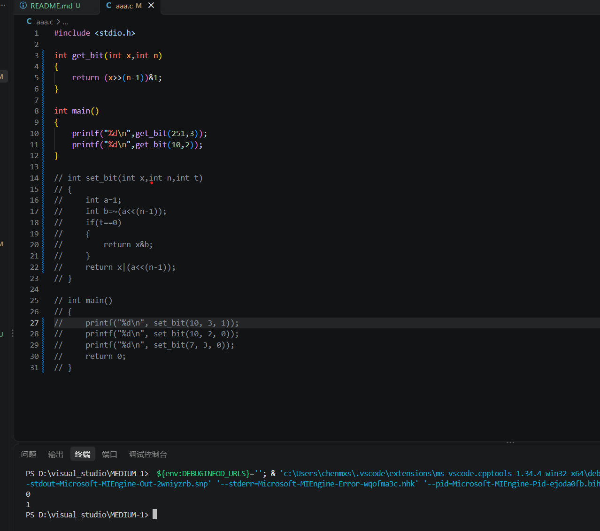
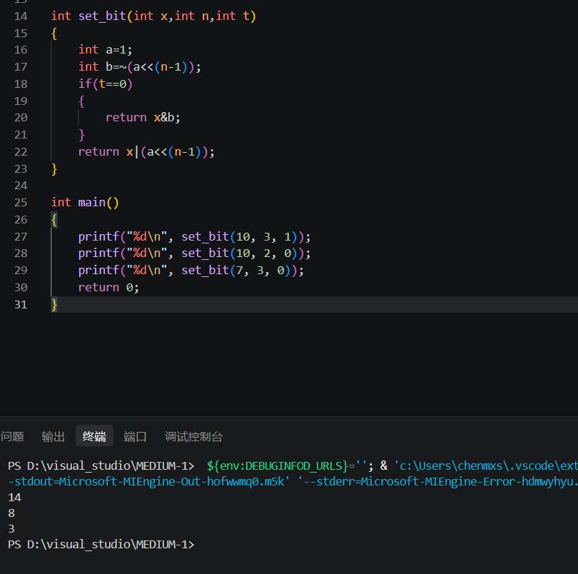
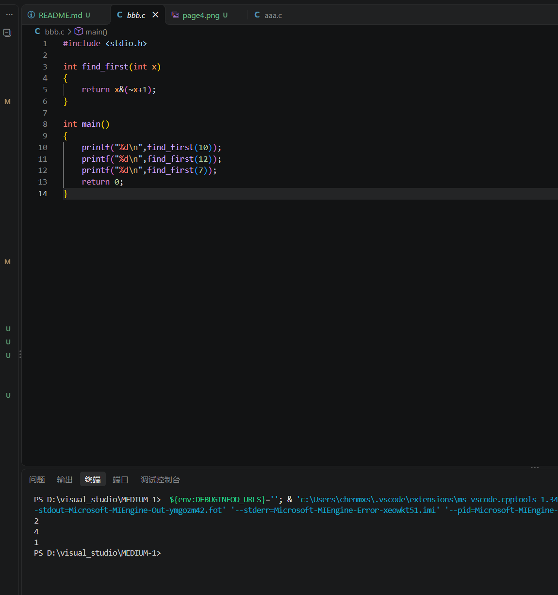
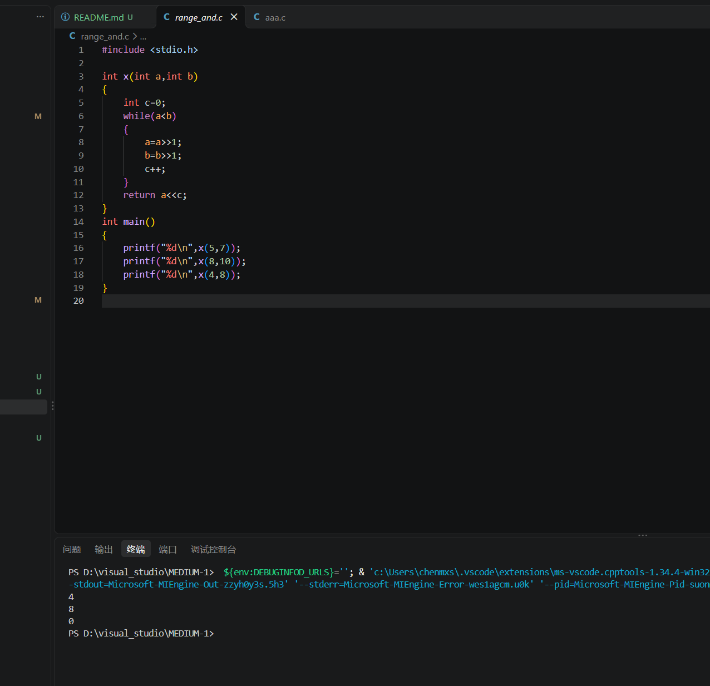
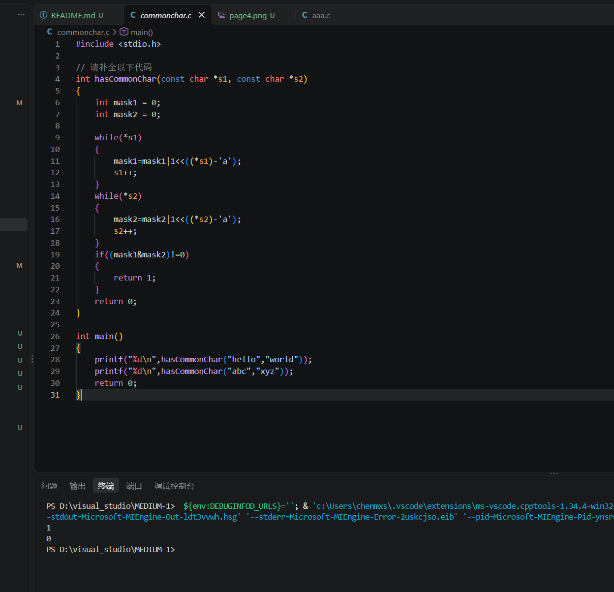
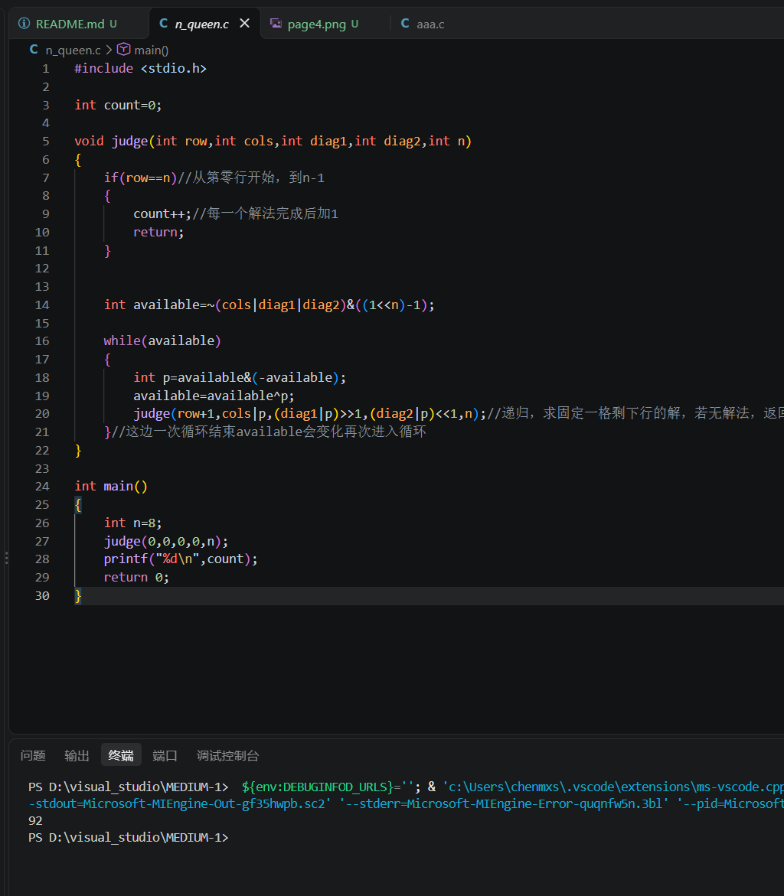
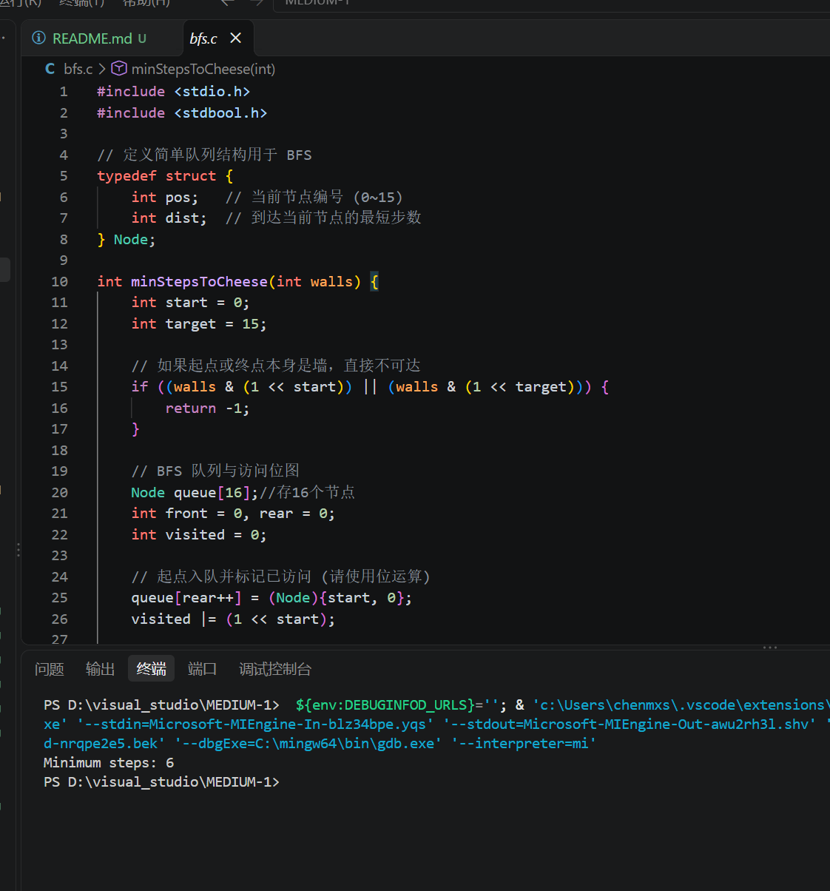

# MEDIUM1

## 模块一

(1)211二进制（128+64+16+2+1）：11010011(代码实现见bit_ops.c)

(2)10110110(若为有符号则为01001010，即-74)无符号为182（代码实现见calculate.c）

(3)通过判断最后一位为是否为1，若为一则为奇数，反之则为偶数，代码实现见is_odd.c

## 模块二

(1)输出结果：8,29,21,60(a&b=00001000,a|b=00011101,a^b=00010101,a<<2=00110000,b>>1=00001100,(a << 2) | (b >> 1)=00111100)

(2)原数右移（n-1）位并&1

int get_bit(int x,int n)

{

    return (x>>(n-1))&1;

}

int main()

{

    printf("%d\n",get_bit(251,3));

    printf("%d\n",get_bit(10,2));

}

(3)分两种情况，赋值1时取a=1，再通过a<<(n-1)|x,使特定位置赋值1，赋值0时，对a<<(n-1)取反，使特定位置赋值0

int set_bit(int x,int n,int t)

{

    int a=1;

    int b=~(a<<(n-1));

    if(t==0)

    {

        return x&b;

    }

    return x|(a<<(n-1));

}

int main()

{

    printf("%d\n", set_bit(10, 3, 1));  

    printf("%d\n", set_bit(10, 2, 0));  
    
    return 0;

}

(4)相反数相互&可得到第一位1

#include <stdio.h>

int find_first(int x)

{

    return x&(~x+1);

}

int main()

{

    printf("%d\n",find_first(10));

    printf("%d\n",find_first(12));

    printf("%d\n",find_first(7));

    return 0;

}

(5)找到第一次进位处，进位后代码归零

#include <stdio.h>

int x(int a,int b)

{

    int c=0;

    while(a<b)

    {

        a=a>>1;

        b=b>>1;

        c++;

    }

    return a<<c;

}

int main()

{
    printf("%d\n",x(5,7));

    printf("%d\n",x(8,10));

    printf("%d\n",x(4,8));

}

### 思考题

(1)区别：逻辑运算（&&, ||, !）针对的是“布尔值”（真或假），结果只能是 0 或 1，逻辑运算具有短路特性。位运算（&, |, ~, ^）针对的是二进制位（bit），结果依然是一个整数，位运算没有短路特性，两边的表达式无论结果如何，都会按位进行运算。

联系：位运算可以看作是逻辑运算在底层硬件上的实现。逻辑运算在本质上是对变量进行整体判断，而位运算则是对每一位进行逻辑判断。

(2)1. 交换律 2. 结合律 3. 分配律(等等)

(3)因为有符号数与无符号数的设计不同

1. 逻辑右移

规则：高位统一补 0。适用对象：无符号数.意义：由于无符号数没有符号位，逻辑右移等价于数学上的“除以 2 的幂并向下取整”。

2. 算术右移

规则：高位补 符号位（正数补 0，负数补 1）。适用对象：有符号数.意义：为了保持负数的符号属性。

## 模块三

#include <stdio.h>

// 请补全以下代码

int hasCommonChar(const char *s1, const char *s2) 

{

    int mask1 = 0;

    int mask2 = 0;

    while(*s1)

    {

        mask1=mask1|1<<((*s1)-'a');//1<<((*s1)-'a')把26个字母映射到26位上，((*s1)-'a')字符转成0-25

        s1++;//读取s1指针的下一格

    }

    while(*s2)

    {

        mask2=mask2|1<<((*s2)-'a');

        s2++;

    }

    if((mask1&mask2)!=0)//判断是否重合

    {

        return 1;

    }

    return 0;

}

int main()

{

    printf("%d\n",hasCommonChar("hello","world"));

    printf("%d\n",hasCommonChar("abc","xyz"));

    return 0;

}

## 模块四

#include <stdio.h>

int count=0;

void judge(int row,int cols,int diag1,int diag2,int n)//设置行列，两个斜角

{

    if(row==n)//从第零行开始，到n-1

    {

        count++;//每一个解法完成后加1

        return;//最后返回的是count（次数）

    }

    int available=~(cols|diag1|diag2)&((1<<n)-1);//寻找可放置的地方(cols|diag1|diag2)&((1<<n)-1)把n+1位及以上取0防止干扰

    while(available)//所有可能

    {

        int p=available&(-available);

        available=available^p;

        judge(row+1,cols|p,(diag1|p)>>1,(diag2|p)<<1,n);//递归，求固定一格剩下行的解，若无解法，返回到上一行固定下一格，继续试解

    }//这边一次循环结束available会变化再次进入循环

}

int main()

{

    int n=8;

    judge(0,0,0,0,n);

    printf("%d\n",count);

    return 0;

}

## 模块五

#include <stdio.h>

#include <stdbool.h>

// 定义简单队列结构用于 BFS

typedef struct {

    int pos;   // 当前节点编号 (0~15)

    int dist;  // 到达当前节点的最短步数

} Node;

int minStepsToCheese(int walls)
{

    int start = 0;

    int target = 15;

    // 如果起点或终点本身是墙，直接不可达

    if ((walls & (1 << start)) || (walls & (1 << target))) 
    
    {

        return -1;

    }

    // BFS 队列与访问位图
    Node queue[16];//存16个节点

    int front = 0, rear = 0;

    int visited = 0;

    // 起点入队并标记已访问 (请使用位运算)

    queue[rear++] = (Node){start, 0};

    visited |= (1 << start);

    // 上、下、左、右四个方向的节点偏移量

    int dr[4] = {-1, 1, 0, 0};

    int dc[4] = {0, 0, -1, 1};

    //请在TO DO 和END OF TO DO 行之间补全代码：

    while(front<rear)

    {

        Node current=queue[front++];

        if(current.pos==target)//结束条件

        {

            return current.dist;//返回步数

        }

        int r=current.pos/4;//变成4*4数组

        int c=current.pos%4;

        for(int i=0;i<4;i++)

        {

            int a=r+dr[i];

            int b=c+dc[i];

            if(a<0||a>=4||b<0||b>=4)

            {

                continue;

            }

            int next=a*4+b;//转化为原来一条的格式，用于存贮当前所在格及表示已走过格子 visited

            if((walls&(1<<next))||(visited&(1<<next)))//数组下标少1

            {

                continue;

            }

            queue[rear++]=(Node){next,current.dist+1};

            visited|=(1<<next);

        }

    }

    return -1; // 无法到达

}

int main() 
{
    int walls = (1 << 5) | (1 << 10); // 5号和10号格子是墙

    int steps = minStepsToCheese(walls);

    printf("Minimum steps: %d\n", steps); // 应输出 6

    return 0;

}

